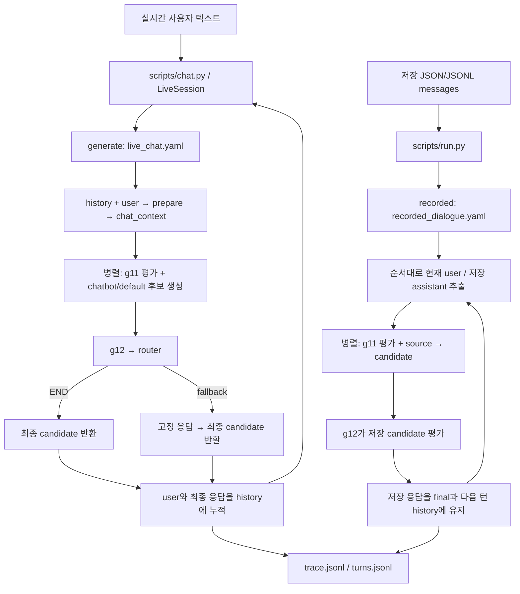

# guardbench

## Config 중심 실행과 관리

실험별 동작은 `configs/pipelines/*.yaml`, 모델별 실행 값은 `configs/models.yaml`에서 관리한다.
기존 노드를 조합하거나 모델·창 크기·분기 정책을 바꾸는 실험은 **config를 수정하고 같은 CLI로 실행**한다.
실험마다 전용 Python 스크립트를 추가하지 않는다. 새로운 추론 방식이나 평가 로직은
`src/guardbench/nodes/`의 래퍼로 구현하고, 이후에는 YAML의 `use/params`로 선택한다.

| 관리 대상 | 설정 위치 | 대표 값 |
| --- | --- | --- |
| 입력 모드와 가드 평가 창 | pipeline의 `input` | `response_mode`, `context_messages` |
| 노드 구현과 연결 | pipeline의 `nodes` | `use`, `in`, `out`, `params`, `type` |
| 순차/병렬 실행과 최종 응답 | pipeline의 `flow`, `final` | `[g11, bot]` 병렬, `final: candidate` |
| 결과에 남길 노드 출력 | pipeline의 `outputs` | `[g11, fb]` |
| 재생성/대체 응답 정책 | g12/router/fallback의 `params` | `mode`, `max_retries`, 이동 대상, `text` |
| 턴 실행 한도 | pipeline의 `limits` | `max_steps` |
| 모델·장치·생성 설정 | `configs/models.yaml`의 모델 별칭 | `model_id`, `revision`, `device`, sampling 등 |
| 인증 값 | `guardbench/.env` | 모델 설정의 `api_key_env`에 지정한 환경변수 |
| 입력 파일·선택 범위·출력 경로 | 실행 CLI | `--data`, `--split`, `--limit`, `--out`, `--concurrency` |

### 상황에 맞는 pipeline 선택

| 상황 | `--pipeline`에 지정할 파일 | 현재 구성 |
| --- | --- | --- |
| 저장 응답을 유지하며 Qwen 입력 가드 평가 | `configs/pipelines/recorded_dialogue.yaml` | recorded, Qwen g11 + 저장 응답 source → mock g12 |
| 실시간 사용자 입력과 실제 챗봇 생성 | `configs/pipelines/live_chat.yaml` | generate, mock g11 + 실제 chatbot → mock g12 → fallback router |

`generate`의 messages 입력은 마지막이 user여야 하며 마지막 user에 대해서만 생성한다.
`recorded`는 저장된 user/assistant 쌍을 순서대로 평가하고 원래 응답을 유지한다.
recorded pipeline에는 `chatbot/*` 노드를 선언하지 않고 source 노드를 사용한다.
JSONL 빌드의 `--mode`도 실행할 pipeline의 `input.response_mode`에 맞춘다.

### config를 바꿀 때 함께 맞추는 값

**노드 선택:** `use: guard_in/qwen3guard`는 등록된 가드 래퍼를,
`use: chatbot/default`는 실제 챗봇 래퍼를 선택한다. `params` 키는 선택한 클래스의
생성자 인자와 맞춘다. 예를 들어 Qwen으로 교체하면 mock의 `keywords/scope` 대신
`model: qwen3guard`를 지정한다. 노드 입출력의 상세 형식은 아래 가드레일 규격을 따른다.

**모델 선택:** `params.model`은 `models.yaml`의 별칭이다. 모델만 바꾸려면 해당 별칭의 값을
수정하고, 다른 모델 설정 파일을 사용하려면 해당 노드에 다음처럼 지정한다.
아래는 g11 선언 부분이며 나머지 노드와 flow는 선택한 pipeline에 함께 둔다.

```yaml
g11:
  use: guard_in/qwen3guard
  in: [context, user]
  out: g11
  params:
    model: qwen3guard
    models_config: configs/models.yaml
```

챗봇도 자신의 `params.model/models_config`를 사용한다. 별도 models_config를 선택할 때는
그 파일을 사용할 가드와 챗봇 각각에 지정한다. Chat backend는 `openrouter` 또는
`openai_compatible`, Qwen 가드는 `local_hf`와 `variant: Gen`을 사용한다.
Qwen의 size를 바꾸면 model_id/local_path에 적용되는 값과 revision, 실제 로컬 모델 파일을 함께 맞춘다.
`${OPENROUTER_CHATBOT_MODEL}` 같은 환경변수 치환은 Chat backend의 model_id에서 적용된다.
YAML 전체에 임의의 환경변수 치환이나 설정 상속을 전제로 작성하지 않는다.

**배선과 실행 순서:** 출력 키를 바꾸면 생산 노드의 `out`, 소비 노드의 `in`, 기록할
`outputs`를 함께 수정한다. `[g11, bot]`은 같은 단계에서 병렬로 실행되므로
서로의 출력에 의존할 수 없다. candidate와 g11을 읽는 g12는 그 다음 단계에 둔다.
router는 `type: router`와 순차 flow 항목으로 선언한다. 이동 대상은 state 키가 아니라
노드 이름이며, 선언한 모든 노드를 flow에 정확히 한 번 넣는다.

**분기 정책:** `guard_out/mock.params.mode: retry/fallback`과 router의
`retry_target/fallback_target`을 함께 맞춘다. `max_retries`는 추가 후보 생성 횟수이고
`limits.max_steps`는 한 턴의 flow 실행 횟수 한도다. fallback이 필요하면
해당 노드와 `params.text`를 함께 선언한다. 노드가 반환할 feedback 형식과 router가
읽는 키도 같은 규격으로 유지한다.

**창 크기:** `input.context_messages`는 가드용 최근 메시지 수다.
`prepare.params.max_chars/recent_messages/summary_chars/excerpt_chars`는 챗봇 입력 압축 값이다.
가드 창과 챗봇 입력 예산은 각각 해당 config에서 조정한다.

### 공통 실행 명령과 재현 정보

`guardbench/`에서 기존 CLI를 사용한다. 한 실행에는 완결된 pipeline YAML 한 개를 지정한다.
입력 파일과 출력 경로는 CLI에서 선택하며 pipeline YAML의 `data/out` 키로 설정하지 않는다.

**CRADLE test 대화 한 개 + Qwen g11:** 아래 블록 전체를 콘솔에 붙여 넣는다.
매번 새 출력 폴더를 만들어 재실행할 수 있다.

```bash
cd /home/yujin/mentalguardrail-chatbot/guardbench
source ../.venv/bin/activate
mkdir -p outputs
CRADLE_RUN_DIR=$(mktemp -d outputs/cradle_qwen_g11.XXXXXX)

python scripts/run.py \
  --pipeline configs/pipelines/recorded_dialogue.yaml \
  --data data/built/recorded/cradle_dialogue.jsonl \
  --split test --limit 1 --concurrency 1 --show-turns \
  --out "$CRADLE_RUN_DIR"

printf '결과 폴더: %s\n' "$CRADLE_RUN_DIR"
```

`$CRADLE_RUN_DIR/turns.jsonl`에서 턴별 입력·응답·g11 결과를,
`$CRADLE_RUN_DIR/trace.jsonl`에서 노드별 입출력을 확인한다.
test 전체를 실행하려면 `--limit 1`을 제거하고, 모든 split을 실행하려면 `--split test`도 제거한다.
모델·장치는 `configs/models.yaml`, 가드 선택과 흐름은 `recorded_dialogue.yaml`에서 바꾼다.

**실시간 대화 + 실제 챗봇:** API 키와 모델 ID를 `.env`에 설정한 뒤 별도로 실행한다.

```bash
cd /home/yujin/mentalguardrail-chatbot/guardbench
source ../.venv/bin/activate
mkdir -p outputs
LIVE_RUN_DIR=$(mktemp -d outputs/live_run.XXXXXX)

python scripts/chat.py \
  --pipeline configs/pipelines/live_chat.yaml \
  --out "$LIVE_RUN_DIR"
```

CLI의 상대 경로는 현재 작업 디렉터리 기준이다. 노드의 `models_config`와 Qwen의
상대 `local_path`는 `guardbench/` 기준이다. 다른 디렉터리에서 실행할 때는
CLI 경로를 절대 경로로 지정하거나 먼저 `guardbench/`로 이동한다.
설정 로드 시 등록된 use, 생성자 params, 필수 입력의 생산 순서, router 배치,
reserved output 키, recorded 모드 등을 검증한다. 입력 JSONL은 별도로 검증한다.

실험을 재현하려면 사용한 pipeline/models YAML과 CLI 인자, 입력 원본의 경로·해시를
결과와 함께 보관한다. 현재 Runner는 config 파일을 결과 폴더에 자동 복사하지 않으므로
사용한 설정을 직접 함께 저장한다. 인증 값은 `.env`로 관리하고 모델 설정에는 환경변수 이름을 둔다.
재실행은 새 `--out` 경로를 사용한다. config만으로 제어할 범위가 늘어날 때는
먼저 해당 노드의 생성자/입출력 규격에 옵션을 추가하고 README와 YAML 예시를 함께 갱신한다.

## 모듈 구조와 교체 기준

노드는 입력을 받아 자기 결과만 반환하고, config는 노드 선택과 연결을 담당한다.
Runner는 선택된 노드를 실행하며 가드 모델이나 챗봇 provider의 내부 동작을 해석하지 않는다.
가드레일과 챗봇을 교체할 때는 **입출력 규격을 유지하고 구현 또는 모델 별칭을 선택**한다.

| 모듈 | 책임 | 변경하는 상황 |
| --- | --- | --- |
| `scripts/run.py`, `scripts/chat.py` | 배치/실시간 입력, config 선택, 실행 시작 | 공통 CLI 기능을 바꿀 때 |
| `core/node.py` | Node 인터페이스, 등록과 구현 조회 | 공통 노드 규칙을 바꿀 때 |
| `core/pipeline.py` | YAML 로드, 입출력 배선·flow 검증 | 공통 config 문법을 바꿀 때 |
| `core/state.py`, `core/runner.py`, `core/session.py` | 턴 상태, history/context, 실행 순서·병렬·분기 | 공통 실행 동작을 바꿀 때 |
| `nodes/guard_in/` | 입력 가드 래퍼: context/user → 판정 | 입력 가드 모델이나 평가 로직을 교체할 때 |
| `nodes/guard_out/` | 응답 평가와 feedback: candidate/g11 → fb | 응답 평가 로직을 교체할 때 |
| `nodes/chatbot/` | chat_context/fb → 문자열 candidate | 챗봇 입력 구성이나 생성 로직을 교체할 때 |
| `nodes/misc/` | 입력 준비, 저장 응답 source, fallback | 전처리·응답 공급 방식을 바꿀 때 |
| `nodes/routers/` | feedback과 호출 수 → 다음 노드 이름 또는 END | 재생성·차단·fallback 정책을 바꿀 때 |
| `llm/client.py`, `llm/openrouter.py` | 챗봇 모델 설정 조회, backend 선택과 API 호출 | provider/전송 방식을 바꿀 때 |
| `trace/recorder.py` | 노드 실행과 턴 결과 저장 | 공통 기록 형식을 바꿀 때 |

현재 Qwen의 추론·파싱·모델 재사용은 `nodes/guard_in/qwen3guard.py` 안의 함수로 관리한다.
여러 노드가 같은 추론/파싱을 실제로 공유하게 되면 필요한 공통 코드를 분리한다.
새 실험이나 모델 이름만으로 파일·실행 스크립트를 추가하지 않는다.

### 가드레일 교체

g11 구현은 `context, user`를 받아 `label, categories, raw`를 반환하는 규격을 유지한다.
같은 위치의 `use`와 그 구현이 받는 `params`를 바꾸면 다른 입력 가드를 연결할 수 있다.
아래는 pipeline의 `nodes` 안에서 사용할 g11 선언 예시다:

```yaml
g11:
  use: guard_in/qwen3guard
  in: [context, user]
  out: g11
  params: {model: qwen3guard}
```

키워드 mock으로 바꾸면 `use: guard_in/mock`,
`params: {scope: context, keywords: [scared, suicide]}`로 지정한다.
교체 전 구현의 전용 params를 그대로 넘기지 않는다.
g12도 `context, user, candidate, g11` 입력과 router가 읽는 feedback 키를 유지하면
`use/params` 교체로 연결할 수 있다. 모델의 원래 라벨과 출력은 raw에 보존하고
다음 노드가 읽는 필드는 래퍼에서 맞춘다. 상세 양식은 아래 가드레일 노드 입출력 규격을 따른다.

### 챗봇 교체: 모델, backend, 노드

| 바꾸려는 것 | 변경 위치 | 유지할 연결 |
| --- | --- | --- |
| 같은 Chat API 방식의 모델 | `models.yaml`의 model_id/sampling 또는 bot의 `params.model` 별칭 | `use: chatbot/default`, `in/out` |
| OpenRouter ↔ 호환 API 서버 | 해당 모델 별칭의 backend/base_url/api_key_env | `chatbot/default`의 입력·출력 |
| mock ↔ 실제 챗봇 | bot의 `use/params` | `in: [chat_context, 'fb?']`, `out: candidate` |
| 새로운 생성 방식 | `nodes/chatbot/` 래퍼 또는 필요한 backend 구현 | 문자열 candidate 반환 |

챗봇 노드가 받는 `chat_context`는 `{"summary": "...", "messages": [...]}`다.
messages는 현재 user로 끝나는 role/content 목록이며, `fb?`는 첫 생성에 없으면 None,
재생성에서는 이전 feedback 객체다. 반환값은 `{"candidate": ...}`가 아니라 **응답 문자열 자체**다.
다음 가드는 YAML의 `out: candidate`로 저장된 문자열을 읽는다.

`chatbot/default`는 모델 설정을 읽고 `Backend.generate(messages) -> str`로 추론을 호출한다.
provider 연결은 backend에서 처리하고, 노드는 summary/feedback을 모델 입력으로 구성한다.
새 backend를 구현할 때는 `generate()`와 `close()` 인터페이스를 맞추고
`llm/client.py`의 backend 선택 경로에 연결한다. 현재 `openrouter/openai_compatible`은
`llm/openrouter.py`의 같은 클라이언트를 사용한다.
로컬 Qwen 가드의 `local_hf` 설정은 가드 래퍼에서 처리한다.

### 노드 등록과 수명 관리

`nodes/<종류>/<구현>.py`의 클래스에 `@register("<종류>/<구현>")`를 붙이고
`Node`를 상속해 `async run(inputs)`를 구현한다. YAML의 `use`는 이 등록 이름이다.
예를 들어 `guard_in/qwen3guard`를 선택하면 해당 모듈을 자동 import한다.
같은 이름을 중복 등록하지 않으며 생성자 인자는 YAML `params`와 맞춘다.

pipeline에서 `g11`, `bot`, `source`는 **노드 인스턴스 이름**, `use`는 **구현 이름**,
`out`은 **state에 저장할 키**다. 예를 들어 bot의 구현을 교체해도 `out: candidate`를
유지하면 g12 입력을 그대로 사용할 수 있다. 노드 이름을 바꾸면 flow와 router 이동 대상도 바꾼다.
입출력 키를 바꾸면 생산자 out, 소비자 in, 기록할 outputs를 함께 수정한다.

노드는 다른 노드를 직접 호출하거나 import해서 연결하지 않는다.
데이터는 선언한 in/out으로 전달하고 실행 순서와 재생성은 flow/router가 결정한다.
노드 반환값은 out 하나에 저장하고 history/user/context 등의 초기 상태를 덮어쓰지 않는다.
가드 정답 라벨은 metadata로 기록하며 모델 입력에 자동으로 섞지 않는다.

config 검증 때 생성자가 호출되고, 실제 실행에서는 턴마다 새 노드 인스턴스를 만든다.
생성자에서는 설정을 검증하고 모델 로드·API 추론은 run 단계에서 수행한다.
큰 모델은 설정에 맞는 자원을 재사용하고 공유 접근을 관리한다.
호출 수·재생성 feedback은 턴 단위이고, 다음 턴으로 이어지는 대화는 Runner/Session의 history로 관리한다.
API 클라이언트 등 호출 자원은 실패 시에도 정리한다.
래퍼 교체를 확인할 때는 config 로드, 입력 규격, 출력 형식, history 유지와 trace의 use를 검증한다.

## 로컬 데이터셋 → 편집 가능한 입력 JSONL

`scripts/build_datasets.py`로 **attunebench, cradle_dialogue, sim_vail, dailydialog,
esconv**를 Runner 입력으로 변환한다. `datasets/`의 원본 파일은 유지하고,
JSONL 각 줄에 대화 한 개와 원본 파일·행·발화 위치를 연결한다.
빌드는 네트워크나 모델을 호출하지 않는다. Python 3.11 이상을 사용한다.

`guardbench/`에서 실행:

```bash
python -m pip install -r requirements-data.txt
python scripts/build_datasets.py --out-dir data/built/recorded
# 한 데이터셋 / test split만 빌드
python scripts/build_datasets.py --dataset cradle_dialogue --split test --out-dir data/built/test
# 데이터셋마다 최대 3줄로 빠르게 확인
python scripts/build_datasets.py --limit 3 --out-dir data/built/smoke
```

기본 `--datasets-root`는 작업공간의 `datasets/`이고 다른 위치를 지정할 수 있다.
출력은 `<out-dir>/<dataset>.jsonl` 다섯 개다. 기존 파일은 덮어쓰지 않으며,
각 파일의 변환·검증을 마친 뒤에만 공개한다. 후속 데이터셋에 오류가 나면
앞서 완성된 파일은 남는다. 새 출력 폴더에서 다시 빌드하거나 실패한 데이터셋만 선택한다.

| 데이터셋 | 사용하는 원본 | 대화/화자 처리 |
| --- | --- | --- |
| attunebench | [Test Samples/Sample200](../datasets/02_multiturn_contextual/attunebench/Test%20Samples/Sample200) | `conversationId`, `turns[].userMessage/llmResponse`. 중복 subsample과 모델 실험 결과는 포함하지 않는다. |
| cradle_dialogue | [data/*.parquet](../datasets/02_multiturn_contextual/cradle_dialogue/data) | split별 `turn_id=0` 경계로 세션 분리. `User:` → user, `Listener:` → assistant. |
| sim_vail | [data/v1](../datasets/02_multiturn_contextual/sim_vail/data/v1) | 810개 주요 transcript의 `target_messages`. auditor용 `messages`와 control 실험은 제외한다. |
| dailydialog | [default](../datasets/03_conversation/dailydialog/default) | Parquet 한 행이 한 대화. 첫 화자를 user, 둘째를 assistant로 대응시킨다. 실제 챗봇 응답을 뜻하지 않는다. |
| esconv | [ESConv.json](../datasets/03_conversation/esconv/ESConv.json) | `seeker` → user, `supporter` → assistant. 원본 전체 1,300개를 `unsplit`으로 보존한다. |

`--split`은 CRADLE/DailyDialog에만 적용되고 기본은 train/validation/test 전체다.
실제 CRADLE Parquet에는 `dialogue_id`가 없으므로 ID를 `파일명:시작행`으로 만들고
`source.session_boundary`에 `turn_id_reset_to_zero`를 표시한다.
train/validation의 일부 접두어 없는 문장·목록 행은 앞선 화자의 연속 발화로 처리하고
각 원본 위치에 `role_mapping: unprefixed_continuation_of_previous_speaker`를 남긴다.
연속된 같은 화자 발화는 줄바꿈으로 합치며 `native.merged_parts`에 원본을 보존한다.

### 입력과 원본 연결 형식

아래는 형식 설명용 예시이며 SHA-256은 실제 빌드 시 계산한다:

```json
{
  "dialogue_id": "esconv:unsplit:row-0",
  "dataset": "esconv",
  "split": "unsplit",
  "source_dialogue_id": "row-0",
  "source": {
    "path": "datasets/03_conversation/esconv/ESConv.json",
    "dataset_path": "ESConv.json",
    "sha256": "<원본 파일 SHA-256>",
    "repository_url": "https://github.com/thu-coai/Emotional-Support-Conversation",
    "row_index": 0
  },
  "native": {"emotion_type": "anxiety"},
  "messages": [
    {"role": "user", "content": "Hello\n", "source": {"parts": [{"pointer": "/0/dialog/0"}]}, "native": {"speaker": "seeker", "content": "Hello\n", "annotation": {}}},
    {"role": "assistant", "content": "Hello, what would you like to talk about?", "source": {"parts": [{"pointer": "/0/dialog/1"}]}, "native": {"speaker": "supporter", "content": "Hello, what would you like to talk about?", "annotation": {"strategy": "Question"}}}
  ]
}
```

- `source.path`: 작업공간 기준 원본 경로. 외부 datasets-root이면 절대 경로다.
- `source.sha256`: 원본 버전을 확인하는 파일 해시. `messages[].content`를 편집해도 원본 해시는 그대로 유지한다.
- `repository_url`: 확인 가능한 upstream 저장소. AttuneBench/SIM-VAIL은 checkout 커밋의 `revision`과 `file_url`도 기록한다.
  CRADLE/DailyDialog는 로컬 파일만으로 다운로드 저장소를 확정할 수 없어 기본 URL은 null이다.
  확인한 URL을 `--source-url cradle_dialogue=https://... --source-url dailydialog=https://...`로 지정할 수 있다.
- `messages[].source.parts`: 해당 대화의 `source.path` 파일 안에서 원문을 찾는 위치.
  JSON은 JSON Pointer, Parquet은 0부터 시작하는 `row_index`와 그 행 안의 JSON Pointer다.
  합친 메시지는 모든 구성 발화 위치를 남긴다.
- `native`: 원본 프로필·설문·라벨·주석. CRADLE `labels`, DailyDialog `act/emotion`,
  AttuneBench `annotations`, ESConv `annotation`, SIM-VAIL `metadata`를 보존한다.
  SIM-VAIL의 text 블록만 `content`에 사용하고 reasoning 블록은 메시지 `native`에 보존한다.
  SIM-VAIL의 auditor events와 별도 turn-score 파일을 병합하는 단계는 포함하지 않는다.

원문을 찾을 때는 `source.path`를 열고 메시지의 `source.parts`를 따라간다.
`content`를 수정해도 `source`와 `native`를 유지하면 편집한 입력과 원문을 비교할 수 있다.
Runner는 추가 필드를 결과의 metadata에 남기며 가드/챗봇 대화 입력에는 role/content만 사용한다.

### 편집 후 실행

기본 `--mode recorded`는 저장 응답 평가용이다. 선두 assistant와 마지막 응답 없는 user는
`excluded_messages`에 위치·원문을 남기고 실행 메시지에서 제외한다.
JSONL에서 `messages[].content`를 편집한 뒤 검증·실행한다:

```bash
python scripts/build_datasets.py --validate-only data/built/recorded/esconv.jsonl
python scripts/run.py --pipeline configs/pipelines/recorded_dialogue.yaml \
  --data data/built/recorded/esconv.jsonl --out outputs/esconv_recorded
```

새 응답 생성 입력은 `--mode generate`로 만든다. 원본의 각 user 발화마다 별도 JSONL 행을
만들고 그 발화까지의 history만 포함한다. 현재 저장 assistant 응답과 이후 메시지는 들어가지 않는다.
서로 다른 행에서 같은 원본 대화를 찾을 때는 `source_dialogue_id`와 `source`를 사용한다.

```bash
python scripts/build_datasets.py --dataset esconv --mode generate --out-dir data/built/generate
python scripts/build_datasets.py --mode generate --validate-only data/built/generate/esconv.jsonl
python scripts/run.py --pipeline configs/pipelines/live_chat.yaml \
  --data data/built/generate/esconv.jsonl --out outputs/esconv_generate
```

## ID JSONL 다운로드와 세션 분리

`scripts/prepare_sessions.py`는 ID 스냅샷의 다섯 JSONL을 다운로드하거나 로컬 JSONL을 읽고,
같은 데이터셋의 원본 세션 ID별로 묶는다. 먼저 실제 필드를 확인한다 (`guardbench/`에서 실행):

```bash
python scripts/prepare_sessions.py --inspect
# 로컬 파일도 확인 가능
python scripts/prepare_sessions.py --input esconv=/path/to/esconv.jsonl --inspect
```

비공개 저장소는 읽기 권한이 있는 `GITHUB_TOKEN` 환경변수가 필요하다.
`--inspect`는 원문 텍스트나 토큰을 출력하지 않고 필드명·타입·출현 행 수만 표시한다.
확인한 원본 세션 식별 키를 데이터셋마다 `--session-key DATASET=KEY`로 지정한다.
중첩 필드는 `native.session_id`처럼 지정할 수 있다. 아래 `session_id`는 예시이며 실제 키를 확인해야 한다:

```bash
python scripts/prepare_sessions.py --dataset esconv \
  --session-key esconv=session_id --out data/id_sessions.jsonl
```

전체 다섯 데이터셋을 받으려면 `--dataset`을 생략하고 각 데이터셋의 `--session-key`를 지정한다.
다운로드 원본은 임시 디렉터리에서 처리하고 삭제한다. 결과 파일은 하나이며,
각 줄은 `{"dataset": "esconv", "session_id": "...", "records": [...]}` 형태다.
`records`에는 원본 JSONL 행 전체를 입력 순서대로 보존한다. 겹치는 창을 합치거나 발화를 복원하지 않는다.
세션 ID를 추측하거나 창 ID로 대체하지 않으며, 데이터셋이 다른 같은 ID는 따로 묶는다.
기존 출력 파일을 덮어쓰지 않는다. 이 파일은 세션 분리용이며 현재 Runner 입력 형식으로 변환하는 단계는 포함하지 않는다.

연구용 가드레일 비교 프로젝트다. Phase 0에서는 Qwen3Guard 단독 동작을 확인했고,
Phase 1에서는 모델·네트워크 호출 없이 순수 Python + asyncio 코어와 mock 파이프라인을 구현했다.

가상환경은 상위 작업공간의 `.venv/`에 있다. 아래 CLI 예시는 별도 표시가 없으면
`guardbench/`에서 실행한다. CLI에 지정하는 상대 경로는 현재 작업 디렉터리 기준이며,
chatbot의 `models_config` 상대 경로는 `guardbench/` 기준이다.

상위 작업공간에서 환경을 설치한다:

```bash
python -m venv .venv
.venv/bin/python -m pip install -r guardbench/requirements.txt
```

Qwen3Guard 실행 설정은 `configs/models.yaml`의 `qwen3guard`에 둔다.
`variant: Gen`, `size`, `revision`, `local_path`, `device`, `dtype`, `cpu_threads`,
`max_new_tokens`, `do_sample`을 지정한다. 다운로드된 모델 경로를 사용하며,
`local_path`와 `model_id`의 `{variant}`, `{size}`는 래퍼에서 치환한다.
크기를 바꾸면 새 모델의 revision과 로컬 파일도 함께 준비한다.
`download_manifest.json`이 있으면 설정의 모델 ID/revision과 일치하는지 확인한다.
`device: auto`는 CUDA를 사용할 수 있을 때 `cuda:0`, 그 외에는 CPU를 선택한다.
CPU에서 기본 dtype은 float32다. 장치를 고정하려면 `device: cuda:0` 또는 `device: cpu`로 설정한다.

Qwen 단독 입력 평가는 기존 `scripts/run.py`와 `recorded_dialogue.yaml`로 실행한다.
OpenRouter 키는 실제 챗봇 후보를 생성하는 `live_chat.yaml`에서 사용한다.
Phase 0의 모델·템플릿 확인 기록은 [PHASE0_REPORT.md](PHASE0_REPORT.md)에 있다.

## 배치 실행

상위 작업공간에서 venv를 활성화한 뒤 프로젝트 디렉터리로 이동한다.

```bash
source .venv/bin/activate
cd guardbench
python scripts/build_datasets.py --dataset esconv --mode generate --out-dir data/built/generate
python scripts/run.py --pipeline configs/pipelines/live_chat.yaml --data data/built/generate/esconv.jsonl --out outputs/my_run --concurrency 4
```

이 생성 실행은 `models.yaml`에 지정한 실제 챗봇 모델을 호출한다.
`guardbench/.env`에서 해당 API 키와 모델 ID를 설정한다.

명령에 쓰는 경로는 현재 작업 디렉터리 기준이다. 출력 디렉터리에 trace 파일이 있으면 덮어쓰지 않고 에러를 낸다.

### 파이프라인 실행과 입출력

생성은 `configs/pipelines/live_chat.yaml`, 저장 응답 평가는 `configs/pipelines/recorded_dialogue.yaml`을 사용한다.
`scripts/run.py`는 JSON/JSONL 배치 입력을, `scripts/chat.py`는 실시간 텍스트 입력을 받는다.
실제 추론 노드는 `chatbot/default`이며, `chatbot/mock`은 테스트용으로 유지한다.
저장 대화 평가는 JSONL의 role 순서로 처리하며, `recorded` 모드는 저장된 assistant 응답을 보존해 평가 대상으로 쓴다.
`guardbench/` 디렉터리에서 실행하며, `--out`은 새로 생성할 출력 디렉터리다.

```bash
python scripts/run.py \
  --pipeline configs/pipelines/live_chat.yaml \
  --data data/built/generate/esconv.jsonl \
  --out outputs/my_run \
  --concurrency 4
```



실시간 경로는 설정된 backend/model을 호출한다. 기본 live YAML의 가드와 router는 mock이다.
저장 평가 경로는 `[g11, source] → g12`를 실행하며 chatbot을 호출하지 않는다.
실제 평가 노드는 recorded YAML의 g11/g12 `use`와 `params`를 교체해 연결한다.

`live_chat.yaml`에서 `prepare`는 history와 현재 user를 받아 chatbot용 `chat_context`를 만들고,
`TurnState`는 평가용 context를 준비한다. g11과 bot 호출은 병렬이다. g12가 후보와 g11 결과를 받아
feedback을 만들고 router가 종료 또는 fallback을 선택한다. `final`은 현재 candidate다.

입력 형식:

| 형식 | 동작 |
| --- | --- |
| `{"dialogue_id":"d1","turns":["첫 발화","다음 발화"]}` | 문자열 발화를 차례로 각 턴의 user 입력으로 사용한다. |
| `{"dialogue_id":"d1","messages":[...]}` + `response_mode: generate` | messages가 user로 끝나야 한다. 앞선 메시지를 history로 넣고 마지막 user에 대해 한 턴 생성한다. |
| `{"dialogue_id":"d1","messages":[...]}` + `response_mode: recorded` | 저장된 user/assistant 쌍을 순서대로 처리하고 기존 assistant 응답을 평가 대상으로 유지한다. |

messages 입력은 user/assistant가 번갈아 나와야 하며 맨 앞의 system 메시지 하나를 허용한다. `recorded` 예시는 다음처럼 실행한다:

```bash
python scripts/run.py --pipeline configs/pipelines/recorded_dialogue.yaml \
  --data data/built/recorded/esconv.jsonl --out outputs/recorded_run
```

출력은 실행마다 새 디렉터리에 생성된다. 기존 `trace.jsonl` 또는 `turns.jsonl`이 있으면 덮어쓰지 않고 오류를 낸다.

| 파일 | 내용 |
| --- | --- |
| `trace.jsonl` | 노드별 입력 키/값, 반환값, latency, 오류와 병렬 그룹 실행 기록. 한 줄에 JSON 이벤트 하나. |
| `turns.jsonl` | 턴별 user, 최종 응답(`final`), history/context, response mode, 메타데이터, 설정한 outputs, latency와 오류. 한 줄에 JSON 턴 하나. |

정상 종료 시 CLI는 대화/턴/오류 개수와 출력 경로를 표시한다. 한 건이라도 턴 오류가 있으면 종료 코드는 0이 아니다.
동시 실행 수는 `--concurrency`로 조정한다. pipeline은 다음 두 개를 관리한다:

| 설정 | 동작 |
| --- | --- |
| `live_chat.yaml` | 실제 chatbot 후보를 만들고 mock 가드·router로 종료 또는 fallback을 선택한다. |
| `recorded_dialogue.yaml` | Qwen g11과 저장 응답 source를 병렬 실행한 뒤 mock g12로 feedback을 기록한다. |

다른 실행 정책은 필요한 노드와 params/flow를 이 설정에 맞춰 조정한다.

## 실행 규칙

- `in`의 키만 복사해 노드에 전달한다. `fb?`는 실제 입력 이름 `fb`로 전달하며 없으면 `None`이다.
- 노드의 반환값 전체를 `out` 하나에 저장한다. history·user·예약 메타 키는 노드 출력으로 덮어쓸 수 없다.
- `step_count`는 flow 항목 실행 횟수다. 병렬 그룹과 goto 대상 단독 실행을 각각 1회로 센다.
- `calls`는 실제 노드별 시도 횟수이며 실행 시작 시 증가한다. 노드가 받는 값에는 현재 호출도 포함한다.
- router가 `X`를 반환하면 `X`만 실행한 뒤, `X`가 속한 flow 항목 다음으로 이어간다. 대상이 router면 그 반환값도 즉시 적용한다.
- 노드는 flow에 정확히 한 번 등장해야 한다. router는 순차 항목이어야 하며, 피드백 내용은 코어가 해석하지 않는다.
- 일반 flow 순서에서 필수 입력 생산자를 로드 시 검증한다. goto로 생산자를 건너뛰면 해당 입력 누락을 실행 시 에러로 기록한다.
- 노드 인스턴스는 턴마다 새로 만든다. history 외의 후보·feedback·호출 횟수는 다음 턴에 유지하지 않는다.
- 대화 단위 semaphore로 동시 실행 수를 제한한다. 병렬 노드 오류 시 같은 그룹의 호출을 모두 기다리고 기록한 뒤 대화를 중단한다.
- `turn_index`는 0부터 시작한다. final은 chat history에 들어가는 문자열이어야 한다.
- trace 시각은 UTC ISO 형식, latency는 `perf_counter`로 측정한 초 단위다. 병렬 그룹 wall time도 별도 event로 저장한다.
- 오류 턴에는 `status: error`, 구조화된 `error`, `final: null`을 저장하고 그 대화의 이후 턴을 실행하지 않는다. 다른 대화는 계속한다.

## 새 노드 추가 (5줄)

1. `src/guardbench/nodes/<folder>/<name>.py`를 만든다.
2. `core.node`의 `Node`, `register`를 import하고 클래스에 `@register("<folder>/<name>")`를 붙인다.
3. 생성자에서 YAML `params`를 받고 `async def run(self, inputs)`를 구현한다.
4. 선언된 입력만 사용하고 출력값을 반환한다. 다른 노드를 import하거나 호출하지 않는다.
5. YAML의 `use`, `in`, `out`, `params`, `flow`를 연결한다. 모듈은 `use` 경로로 자동 로드된다.

Phase 1의 초기 mock 파이프라인 검증 기록은 [PHASE1_REPORT.md](PHASE1_REPORT.md)에 있다.

## 대화 한 개 입력과 저장된 대화 처리

JSONL 외에 대화 한 개를 담은 `.json` 파일도 받는다. Python에서는
`await runner.run(dialogue_dict)`로 대화 dict 하나를 직접 전달할 수 있다.
`turns: ["user1", "user2"]` 입력은 generate pipeline에서 차례로 사용자 발화로 처리한다.

```json
{
  "dialogue_id": "example",
  "native": {"label": "unresolved"},
  "messages": [
    {"role": "user", "content": "첫 사용자 발화"},
    {"role": "assistant", "content": "저장된 첫 응답"},
    {"role": "user", "content": "두 번째 사용자 발화"},
    {"role": "assistant", "content": "저장된 두 번째 응답"}
  ]
}
```

messages는 user/assistant가 번갈아 나와야 한다. 맨 앞에 system 메시지 하나는 허용한다.
메시지 content는 문자열이다. 대화의 native·정답·출처 등 추가 필드는 `metadata.dialogue`에 기록한다.
recorded 모드는 처리한 각 user/assistant의 추가 필드를 `metadata.user`와 `metadata.assistant`에 기록한다.
generate 모드는 현재 user의 추가 필드만 기록하며, 이미 지난 메시지와 선두 system의 추가 필드는 별도 기록하지 않는다.
history/context 메시지에는 role/content만 넣고, 정답 등 추가 필드는 평가 노드 입력에서 제외한다.
정답이나 원본 native 라벨을 노드 입력으로 자동 전달하지 않는다.
로컬 corpus의 데이터셋별 변환은 위 `scripts/build_datasets.py`를 사용한다.

두 가지 실행 방식은 YAML에서 정한다:

| input.response_mode | messages 처리 |
| --- | --- |
| generate (기본) | 마지막 메시지는 user여야 한다. 앞선 메시지는 history로 받고 마지막 user에만 새 응답을 생성한다. 기존 응답을 다시 생성하지 않는다. |
| recorded | 저장된 각 user/assistant 쌍을 순서대로 처리한다. 현재 assistant 응답을 recorded_response로 전달하고 기존 응답을 history에 누적한다. |

recorded 모드에서 현재 assistant 응답이 없거나 pipeline이 원래 응답을 교체하면 해당 턴을 error로 기록한다.
저장된 응답은 `misc/recorded_response` 노드로 candidate에 연결한다. 새로운 가드레일·프롬프트는 추가하지 않았다.
새 평가 노드를 추가할 때도 일반 Node와 YAML 배선 규칙을 그대로 사용한다.

```bash
# guardbench/에서 venv Python 사용
python scripts/run.py --pipeline configs/pipelines/recorded_dialogue.yaml --data data/built/recorded/esconv.jsonl --out outputs/my_recorded_run
python scripts/run.py --pipeline configs/pipelines/live_chat.yaml --data data/built/generate/esconv.jsonl --out outputs/my_generate_run
```

평가용 `context`, 기록용 `history`, chatbot 입력인 `chat_context`는 구분된다:

- history: 현재 user 이전의 전체 대화. 현재 assistant 응답과 이후 메시지는 없다.
- user: 현재 user 발화 문자열.
- context: **현재 user를 포함한 최근 최대 5개 user/assistant 메시지**. system 메시지, 현재 assistant 응답과 미래 메시지는 제외한다.
- recorded_response: 저장된 현재 assistant 응답. 생성 모드에서는 None.
- candidate: YAML 노드가 만든 현재 평가 대상 응답. recorded 모드의 성공한 턴에서는 저장된 응답과 동일하다.

창 크기는 `input: {response_mode: recorded, context_messages: 5}`로 설정한다.
두 pipeline 모두 g11에는 context와 user를, g12에는 context·user·candidate·g11을 전달한다.
chatbot은 `prepare`가 만든 `chat_context`만 받는다. 전체 history는 기록과 평가 창 생성에 사용하며 chatbot에 직접 전달하지 않는다.

### Chatbot 입력 압축

`live_chat.yaml`은 `prepare` → chatbot 배선을 사용한다. `misc/chat_context` 노드는
전체 history에서 오래된 메시지의 발췌와 최근 메시지를 만들어 `chat_context`에 저장한다.
chatbot의 입력 키는 `[chat_context, fb?]`다. 재생성 루프에서는 같은 압축 결과를 재사용한다.

```yaml
prepare:
  use: misc/chat_context
  in: [history, user]
  out: chat_context
  params: {max_chars: 8192, recent_messages: 4, summary_chars: 1024, excerpt_chars: 160}
```

`chat_context`는 `summary` 문자열과 `messages` 목록이다. summary는 오래된 메시지의
화자와 원문 일부를 시간 순서대로 모은 발췌이며, 의미를 추론하는 요약 모델을 호출하지 않는다.
messages에는 system 지시, 예산에 들어가는 최근 메시지, 현재 user를 넣는다.
최근 메시지도 길이 예산을 넘으면 오래된 것부터 발췌 대상으로 옮긴다.
전체 history가 길어져도 직렬화된 chat_context는 최대 8192문자다. summary는 최대 1024문자다.
이 제한은 compact JSON으로 직렬화한 `chat_context`의 문자 수이며 토큰 수가 아니다.
실제 API 요청에는 발췌 안내 문구와 별도 feedback 메시지가 더해지므로 전체 요청 크기를 제한하는 값은 아니다.
현재 user와 system 지시만으로 상한을 넘으면 원문을 조용히 자르지 않고 턴 에러를 기록한다.
가드레일의 context는 이 압축 결과를 사용하지 않고 최근 5개 메시지의 원문을 유지한다.
발췌 과정에서 이전 대화의 정보가 빠질 수 있으며, 의미 요약을 도입할 때는 prepare 노드의 use를 교체할 수 있다.

## 평가 결과를 독립된 키로 기록

미래의 평가 노드가 각각 `out: context_label`, `out: chatbot_utterance_label`에 쓴다면
YAML 최상위에 아래 설정을 넣는다. outputs에 나열한 키는 state에 존재하거나 노드가 생산해야 한다.

```yaml
outputs: [context_label, chatbot_utterance_label]
```

turns.jsonl에는 다음처럼 원래 반환값을 기록한다. 아래 라벨 값은 형식 설명용 예시다.

```json
{
  "outputs": {
    "context_label": "unresolved",
    "chatbot_utterance_label": "unsafe"
  }
}
```

core는 라벨을 해석하거나 병합하지 않는다. unresolved는 그대로 보존하며 발표용 이진화는 별도 분석 단계의 선택이다.
해당 분기에서 평가 노드가 실행되지 않으면 그 출력은 null이다. metadata의 정답과 outputs의 예측은 서로 다른 위치에 저장한다.
recorded_dialogue.yaml은 입력 가드·저장 응답 source·응답 가드를 연결하고 outputs에 g11과 fb를 기록한다.
g11은 Qwen3Guard 결과를 기록하고 g12는 mock feedback을 기록한다. 연결과 출력 형식은 아래 설명을 따른다.
turns에는 context·history·원래 응답·원본 메시지 위치(message_index)도 기록해 어떤 창을 사용했는지 확인할 수 있다.

## 실시간 대화와 저장 대화 평가

| 입력 경로 | CLI | 응답 출처 |
| --- | --- | --- |
| 실시간 텍스트 | scripts/chat.py | chatbot/default가 설정된 backend/model로 추론 |
| 저장 JSON/JSONL | scripts/run.py + recorded_dialogue.yaml | 현재 user 뒤에 저장된 assistant 응답 |

작업공간에서 `source .venv/bin/activate` 후 `cd guardbench`로 이동한다.
`.env`에 아래 값을 설정한다. 모델 ID는 사용할 OpenRouter 모델의 ID를 직접 선택한다.

```dotenv
OPENROUTER_API_KEY=<your-key>
OPENROUTER_CHATBOT_MODEL=<provider/model-id>
```

```bash
python scripts/chat.py --pipeline configs/pipelines/live_chat.yaml --out outputs/live_run
```

`user>`에 텍스트를 입력하면 YAML을 실행하고 `assistant>`에 최종 응답을 표시한다.
성공한 user/최종 응답을 history에 추가한 뒤 다음 텍스트를 받는다. `/quit` 또는 EOF로 종료한다.
빈 입력은 건너뛰며 턴 오류 시 history를 추가하지 않고 세션을 중단한다.
`--dialogue-id`로 대화 ID를 지정할 수 있다. 출력 디렉터리는 실행마다 새로 지정한다.
이 CLI는 단일 텍스트 세션이며 별도의 음성 Realtime API를 사용하지 않는다.

live_chat.yaml은 prepare → [g11, bot] → g12 → route 흐름이다.
실제 chatbot은 `chatbot/default`, 현재 가드·router는 mock이다. 모델 호출 없이 CLI를 확인하려면
같은 `live_chat.yaml`에서 bot의 `use`를 `chatbot/mock`, `params`를 `{}`로 바꿔 실행한다.
실제 가드 없이 mock 가드로 실행한 결과를 임상 안전 판정으로 해석하면 안 된다.

`chatbot/default`는 params의 `model` 별칭을 models.yaml에서 읽는다.
backend는 `openrouter` 또는 `openai_compatible`이며 model_id, base_url, api_key_env,
sampling, timeout, max_retries를 설정한다. `models_config` params로 다른 모델 설정 파일을 지정할 수 있다.
`api_key_env: null`은 인증이 필요 없는 로컬 호환 서버에 사용한다.
node 생성과 YAML 로드는 네트워크에 접속하지 않고, node.run에서만 추론을 호출한다.
각 호출의 클라이언트는 성공·실패 모두 close한다. Runner는 backend·모델·API 키를 처리하지 않는다.
OpenAI SDK의 AsyncOpenAI와 Chat Completions를 사용한다.
[공식 OpenAI 대화 상태 문서](https://developers.openai.com/api/docs/guides/conversation-state).

압축된 이전 대화의 원문 발췌는 별도 system 메시지로, recent messages와 현재 user는
role/content 메시지로 전달한다. fb가 있으면 JSON 내용으로 별도 feedback 메시지를 넣는다.
기존 문자 기반 압축을 유지하며 모델 요약을 새로 호출하지 않는다.

저장 대화 평가는 다음처럼 실행한다. 이 경로에는 API 키나 chatbot 모델이 필요하지 않다.
실제 가드를 연결했다면 해당 가드가 요구하는 설정은 별도로 필요하다.

```bash
python scripts/run.py --pipeline configs/pipelines/recorded_dialogue.yaml --data data/built/recorded/cradle_dialogue.jsonl --out outputs/recorded_eval
```

JSONL 한 줄에 dialogue_id와 messages를 넣는다. role/content의 순서대로 각 user/assistant 쌍을 처리한다.
현재 user 이전의 원문 history에서 context를 만들고, 저장된 현재 assistant를 candidate로 연결한 다음
g12를 실행한다. 평가 결과가 어떤 값이든 저장된 응답은 교체하지 않으며 다음 턴 history에 원래 응답을 추가한다.
router가 필요한 평가 흐름은 동일한 YAML goto 규칙을 사용한다.
`input.response_mode: recorded` 설정에 chatbot/* 노드가 있으면 로드 시 에러로 차단한다.
기존 run.py의 JSON, JSONL, turns 문자열 리스트를 이용한 생성용 배치 동작도 유지한다.

### 가드레일 노드 입출력 규격

가드 래퍼는 `Node`를 상속하고 `async def run(self, inputs: dict)`에서 결과를 반환한다.
생성자에는 YAML의 `params`가 전달되고, `run()`에는 YAML의 `in`에 선언한 키만 전달된다.
아래는 현재 g11/g12와 router를 서로 교체해서 연결하기 위한 형식이다.
core는 가드 결과의 내부 스키마나 라벨 의미를 검증하지 않으므로 래퍼와 소비 노드에서 이 형식을 맞춘다.

| 노드 | YAML `in` | 반환값이 저장되는 YAML `out` | 소비 위치 |
| --- | --- | --- | --- |
| g11 입력 가드 | `[context, user]` | `g11` | g12, 입력 gate, 결과 기록 |
| g12 응답 가드 / feedback | `[context, user, candidate, g11]` | `fb` | router, 재생성 chatbot, 결과 기록 |

`g11`/`fb`는 state 키 이름이다. 노드는 **결과 객체 자체**를 반환한다.
예를 들어 `return {"label": "safe", ...}`를 사용하면 `out: g11`이 그 객체 전체를 저장한다.
반환값을 다시 `{"g11": ...}`로 감싸지 않는다. 출력은 JSON으로 저장 가능한 dict/list/문자열/숫자/bool/null로 만든다.
Tensor, 모델 객체, Exception 객체는 반환값에 넣지 않는다.

#### g11 입력: 현재 user를 포함한 평가 창

```json
{
  "context": [
    {"role": "user", "content": "이전 질문"},
    {"role": "assistant", "content": "이전 응답"},
    {"role": "user", "content": "현재 질문"}
  ],
  "user": "현재 질문"
}
```

| 필드 | 타입 | 규칙 |
| --- | --- | --- |
| `context` | `list[dict]` | 시간순 user/assistant 메시지. 각 메시지는 `role`, 문자열 `content`를 포함한다. 기본 최대 5개 **메시지**다. |
| `user` | `str` | 현재 사용자 발화. `context[-1]`의 role은 user이고 content는 이 값과 같다. |

context에는 system, 현재 후보 응답, 미래 발화, 원본 라벨이 들어가지 않는다.
현재 user는 이미 context에 있으므로 모델용 메시지를 만들 때 다시 붙이지 않는다.
`history`는 현재 user 이전의 전체 대화이며, 필요할 때만 YAML `in`에 별도로 선언한다.
`chat_context`는 챗봇용 압축 입력이고 가드의 평가 창은 `context`를 사용한다.

#### g11 출력: 판정 객체

```json
{
  "label": "unsafe",
  "categories": ["Suicide & Self-Harm"],
  "raw": {
    "output": "Safety: Unsafe\nCategories: Suicide & Self-Harm",
    "safety": "Unsafe",
    "categories": ["Suicide & Self-Harm"],
    "parse_error": null
  }
}
```

| 필드 | 타입 | 규칙 |
| --- | --- | --- |
| `label` | `str` | Qwen 래퍼에서는 `safe`, `unsafe`, `controversial`, `unresolved`. 원본 `Safe/Unsafe/Controversial`을 소문자로 대응시키며 파싱 실패는 unresolved다. |
| `categories` | `list[str]` | 모델의 category 이름을 보존한다. Qwen의 `None`은 빈 목록 `[]`으로 대응시킨다. |
| `raw` | `dict` 또는 `null` | 원래 출력과 파싱/모델 정보를 보존한다. Qwen 래퍼는 dict, 중립 mock은 null을 사용할 수 있다. |

현재 g12 mock은 `g11.label`과 `g11.categories`를 읽으므로 두 키를 제공한다.
Qwen의 raw에는 위 예시에 더해 `model_id`, `revision`, `device`, `input_tokens`,
`generated_tokens`가 들어간다. 키워드 mock은 raw에 `matched` 등을 넣는다.
모델별 원문이나 진단 정보는 raw에 두고 downstream이 읽는 label/categories를 맞춘다.

#### g12 입력: 평가 창 + 현재 후보 + g11 결과

```json
{
  "context": [{"role": "user", "content": "현재 질문"}],
  "user": "현재 질문",
  "candidate": "현재 평가할 assistant 응답",
  "g11": {"label": "safe", "categories": [], "raw": null}
}
```

`context`와 `user`는 g11과 같은 값이다. `candidate`는 문자열이며 generate에서는
챗봇 후보, recorded에서는 저장된 assistant 응답이다. `g11`은 입력 가드의 반환 객체 전체다.
응답 moderation 모델에는 `context + [{"role": "assistant", "content": candidate}]`를 전달한다.
g11 판정은 별도 판단 근거로 사용하고 대화 원문 메시지에 섞지 않는다.
g12는 g11과 후보 준비가 끝난 뒤 실행되며, 후보를 재생성하면 새 candidate로 다시 평가한다.

#### g12 출력: router / chatbot에 전달할 feedback

현재 `guard_out/mock`의 retry/fallback 모드 반환 형식은 다음과 같다.
아래 수치는 형식 예시다. constant 모드는 설정한 feedback dict를 그대로 반환한다.

```json
{
  "retry_requested": false,
  "fallback_requested": true,
  "notes": ["Suicide & Self-Harm"],
  "candidate_length": 24
}
```

| 필드 | 타입 | 현재 소비 규칙 |
| --- | --- | --- |
| `retry_requested` | `bool` | router가 재생성 횟수 한도 안에서 bot으로 이동한다. |
| `fallback_requested` | `bool` | router가 fallback으로 이동한다. 둘 다 true면 fallback이 우선한다. |
| `notes` | `list[str]` | 현재 mock은 g11.categories를 복사한다. feedback 전체는 재생성 chatbot에도 전달된다. |
| `candidate_length` | `int` | `len(candidate)`로 구한 문자 수. 토큰 수가 아니다. |

현재 mock은 `g11.label == "unsafe"`일 때 지정한 mode에 따라 요청 flag를 켠다.
controversial/unresolved에는 flag를 켜지 않는다. 실제 응답 평가기를 연결할 때는
해당 라벨에 대한 처리 정책을 가드 또는 router에서 명시한다.
응답 평가 결과를 함께 저장하려면 fb 객체에 `label`, `categories`, `raw`를 추가할 수 있다.
router와 연결하는 요청 flag는 그대로 유지하고, chatbot은 feedback 객체 전체를 받는다는 점을 고려한다.
core는 fb의 label을 g11 라벨과 합치거나 자동으로 판정하지 않는다.

`routers/mock`은 feedback의 요청 키가 없으면 false로 취급한다.
다른 feedback 형식을 반환하는 가드는 소비하는 router도 같은 형식에 맞춰 연결한다.
recorded YAML은 router 없이 평가 결과만 기록하며 저장 응답을 그대로 유지한다.
가드 반환값이 `final` 응답이 되는 것이 아니라 최종 문자열 candidate가 final이 된다.

#### 기록과 오류 처리

YAML의 `outputs: [g11, fb]`를 지정하면 두 객체가 `turns.jsonl`의 `outputs.g11`,
`outputs.fb`에 그대로 저장된다. `trace.jsonl`에는 노드별 입력과 반환값이 기록된다.
원본 정답·출처·주석은 `metadata.dialogue`, `metadata.user`, `metadata.assistant`에 남고
가드 입력으로 자동 전달되지 않는다. 키 이름을 바꾸면 생산 노드의 `out`, 소비 노드의 `in`,
기록할 `outputs`를 함께 바꾼다.

Qwen 출력 파싱 실패는 `label: unresolved`와 `raw.parse_error`로 기록하며
추론이 정상 반환됐으면 턴 status는 ok다. 모델 로드 실패나 입력 길이 초과 등
실행 예외는 Runner가 턴 `status: error`, `error`, `final: null`로 기록하고
해당 대화의 이후 턴을 중단한다. 실행되지 않은 outputs 키는 null로 기록된다.
래퍼는 history/user/context를 덮어쓰지 않고 자신의 반환 객체만 만든다.

### g11 Qwen3Guard 래퍼와 연결

실행은 기존 `scripts/run.py` / `scripts/chat.py`를 사용하고, 가드 구현은
`src/guardbench/nodes/guard_in/qwen3guard.py`의 `Qwen3Guard(Node)`에 둔다.
이 파일에서 모델 로드, tokenizer 챗템플릿 적용, 추론, 출력 파싱을 처리한다.
모델·tokenizer는 프로세스 안에서 재사용하며 첫 `run()` 때 로드한다.
노드 생성자와 YAML 로드 단계에서는 모델을 로드하지 않는다.
로컬 모델 실행은 worker thread에서 처리하고 공유 모델 접근을 직렬화한다.

| 역할 | 구현 위치 | 입력 / 출력 |
| --- | --- | --- |
| g11 입력 평가 | `src/guardbench/nodes/guard_in/qwen3guard.py` | `context, user` → `g11` |
| g12 mock feedback | `src/guardbench/nodes/guard_out/mock.py` | `context, user, candidate, g11` → `fb` |
| 모델 설정 | `configs/models.yaml`의 `qwen3guard` | 로컬 모델 경로, revision, 장치, 생성 설정 |
| 저장 평가 배선 | `configs/pipelines/recorded_dialogue.yaml` | `[g11, source] → g12` |

`recorded_dialogue.yaml`은 다음처럼 g11 래퍼를 선택한다:

```yaml
nodes:
  g11:
    use: guard_in/qwen3guard
    in: [context, user]
    out: g11
    params: {model: qwen3guard}
outputs: [g11, fb]
```

`use`는 `@register("guard_in/qwen3guard")`로 등록된 클래스를 자동으로 불러온다.
다른 설정 파일은 `params.models_config`로 지정하며 상대 경로는 `guardbench/` 기준이다.
실시간에도 같은 래퍼를 연결하려면 `live_chat.yaml`의 g11 `use/params`를 위와 같이 지정한다.
가드를 교체할 때는 해당 위치의 `use/params`를 바꾸고 기존 `in/out/flow`를 사용한다.

래퍼는 현재 user를 포함한 `context`의 role/content만 모델에 전달한다.
user를 중복으로 붙이거나 원본 라벨·주석을 메시지에 넣지 않는다.
`tokenizer.apply_chat_template(messages, tokenize=False)` → tokenize → generate →
새로 생성된 토큰만 decode 순서로 실행하며, context를 조용히 잘라내지 않는다.
모델 컨텍스트 용량을 넘으면 턴 오류로 기록한다.

출력은 `label: safe/unsafe/controversial`, `categories`, `raw`다.
`raw`에는 원래 출력, 원래 Safety/Categories, parse_error, 모델 ID/revision,
장치와 입력/생성 토큰 수를 남긴다. 파싱 실패는 `unresolved`로 기록한다.
가드 결과는 `turns.jsonl`의 `outputs.g11`에, 노드 입출력은 `trace.jsonl`에 저장된다.
g12 mock은 g11 결과에서 feedback을 만들고 recorded 모드의 원래 assistant 응답을 유지한다.
feedback 규칙은 `guard_out/mock.py`에서 확인할 수 있다.

### CRADLE로 g11 실행

환경 활성화와 새 출력 폴더 생성을 포함한 복사 가능한 명령은
[공통 실행 명령](#공통-실행-명령과-재현-정보)에 저장한다.
`--split`은 JSONL의 split 필드로 선택하고 `--limit`은 선택 후 대화 개수를 제한한다.
둘 다 생략하면 전체 입력을 실행한다. `--show-turns`는 각 턴의 user, history/context 길이,
노드 outputs와 최종 응답을 출력한다.
이 경로에서는 g11이 Qwen3Guard-Gen을 호출하고 candidate는 저장된 응답에서 가져온다.

키워드 mock으로 비교하려면 같은 YAML의 g11만 다음으로 교체하고 같은 `run.py`를 사용한다:

```yaml
  g11:
    use: guard_in/mock
    in: [context, user]
    out: g11
    params: {scope: context, keywords: ['freaking out', scared, suicide, self-harm]}
```

mock의 `scope: user`는 현재 user, `scope: context`는 최근 user/assistant 메시지를 검사한다.
키워드는 대소문자를 무시한 부분 문자열로 검사하고 context의 일치 위치·화자는
`raw.matched_messages`에 남긴다.

### 두 경로의 결과 파일

- trace.jsonl: node 입력/출력과 use, 턴·step 식별자, 시간·latency·오류. 병렬 그룹 wall time 별도 event.
- turns.jsonl: 최종 응답, 원문 history/context, outputs 평가 결과, calls, status/error, metadata.
- 실시간: response_mode는 generate, recorded_response는 null, metadata.input_path는 live.
- 저장 평가: response_mode는 recorded, 성공한 턴은 final과 recorded_response가 같다. 원본 message_index와 처리 대상 metadata를 기록한다. 오류 턴의 final은 null이다.
