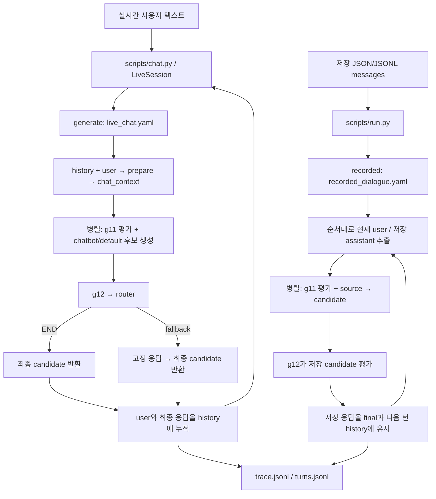

# guardbench

## 로컬 데이터셋 → 편집 가능한 입력 JSONL

`scripts/build_datasets.py`로 **attunebench, cradle_dialogue, sim_vail, dailydialog,
esconv**를 Runner 입력으로 변환한다. `datasets/`의 원본 파일은 유지하고,
JSONL 각 줄에 대화 한 개와 원본 파일·행·발화 위치를 연결한다.
빌드는 네트워크나 모델을 호출하지 않는다. Python 3.11 이상을 사용한다.

`guardbench/`에서 실행:

```bash
python -m pip install -r requirements-data.txt
python scripts/build_datasets.py --out-dir data/built/recorded
# 한 데이터셋 / test split만 빌드
python scripts/build_datasets.py --dataset cradle_dialogue --split test --out-dir data/built/test
# 데이터셋마다 최대 3줄로 빠르게 확인
python scripts/build_datasets.py --limit 3 --out-dir data/built/smoke
```

기본 `--datasets-root`는 작업공간의 `datasets/`이고 다른 위치를 지정할 수 있다.
출력은 `<out-dir>/<dataset>.jsonl` 다섯 개다. 기존 파일은 덮어쓰지 않으며,
각 파일의 변환·검증을 마친 뒤에만 공개한다. 후속 데이터셋에 오류가 나면
앞서 완성된 파일은 남는다. 새 출력 폴더에서 다시 빌드하거나 실패한 데이터셋만 선택한다.

| 데이터셋 | 사용하는 원본 | 대화/화자 처리 |
| --- | --- | --- |
| attunebench | [Test Samples/Sample200](../datasets/02_multiturn_contextual/attunebench/Test%20Samples/Sample200) | `conversationId`, `turns[].userMessage/llmResponse`. 중복 subsample과 모델 실험 결과는 포함하지 않는다. |
| cradle_dialogue | [data/*.parquet](../datasets/02_multiturn_contextual/cradle_dialogue/data) | split별 `turn_id=0` 경계로 세션 분리. `User:` → user, `Listener:` → assistant. |
| sim_vail | [data/v1](../datasets/02_multiturn_contextual/sim_vail/data/v1) | 810개 주요 transcript의 `target_messages`. auditor용 `messages`와 control 실험은 제외한다. |
| dailydialog | [default](../datasets/03_conversation/dailydialog/default) | Parquet 한 행이 한 대화. 첫 화자를 user, 둘째를 assistant로 대응시킨다. 실제 챗봇 응답을 뜻하지 않는다. |
| esconv | [ESConv.json](../datasets/03_conversation/esconv/ESConv.json) | `seeker` → user, `supporter` → assistant. 원본 전체 1,300개를 `unsplit`으로 보존한다. |

`--split`은 CRADLE/DailyDialog에만 적용되고 기본은 train/validation/test 전체다.
실제 CRADLE Parquet에는 `dialogue_id`가 없으므로 ID를 `파일명:시작행`으로 만들고
`source.session_boundary`에 `turn_id_reset_to_zero`를 표시한다.
train/validation의 일부 접두어 없는 문장·목록 행은 앞선 화자의 연속 발화로 처리하고
각 원본 위치에 `role_mapping: unprefixed_continuation_of_previous_speaker`를 남긴다.
연속된 같은 화자 발화는 줄바꿈으로 합치며 `native.merged_parts`에 원본을 보존한다.

### 입력과 원본 연결 형식

아래는 형식 설명용 예시이며 SHA-256은 실제 빌드 시 계산한다:

```json
{
  "dialogue_id": "esconv:unsplit:row-0",
  "dataset": "esconv",
  "split": "unsplit",
  "source_dialogue_id": "row-0",
  "source": {
    "path": "datasets/03_conversation/esconv/ESConv.json",
    "dataset_path": "ESConv.json",
    "sha256": "<원본 파일 SHA-256>",
    "repository_url": "https://github.com/thu-coai/Emotional-Support-Conversation",
    "row_index": 0
  },
  "native": {"emotion_type": "anxiety"},
  "messages": [
    {"role": "user", "content": "Hello\n", "source": {"parts": [{"pointer": "/0/dialog/0"}]}, "native": {"speaker": "seeker", "content": "Hello\n", "annotation": {}}},
    {"role": "assistant", "content": "Hello, what would you like to talk about?", "source": {"parts": [{"pointer": "/0/dialog/1"}]}, "native": {"speaker": "supporter", "content": "Hello, what would you like to talk about?", "annotation": {"strategy": "Question"}}}
  ]
}
```

- `source.path`: 작업공간 기준 원본 경로. 외부 datasets-root이면 절대 경로다.
- `source.sha256`: 원본 버전을 확인하는 파일 해시. `messages[].content`를 편집해도 원본 해시는 그대로 유지한다.
- `repository_url`: 확인 가능한 upstream 저장소. AttuneBench/SIM-VAIL은 checkout 커밋의 `revision`과 `file_url`도 기록한다.
  CRADLE/DailyDialog는 로컬 파일만으로 다운로드 저장소를 확정할 수 없어 기본 URL은 null이다.
  확인한 URL을 `--source-url cradle_dialogue=https://... --source-url dailydialog=https://...`로 지정할 수 있다.
- `messages[].source.parts`: 해당 대화의 `source.path` 파일 안에서 원문을 찾는 위치.
  JSON은 JSON Pointer, Parquet은 0부터 시작하는 `row_index`와 그 행 안의 JSON Pointer다.
  합친 메시지는 모든 구성 발화 위치를 남긴다.
- `native`: 원본 프로필·설문·라벨·주석. CRADLE `labels`, DailyDialog `act/emotion`,
  AttuneBench `annotations`, ESConv `annotation`, SIM-VAIL `metadata`를 보존한다.
  SIM-VAIL의 text 블록만 `content`에 사용하고 reasoning 블록은 메시지 `native`에 보존한다.
  SIM-VAIL의 auditor events와 별도 turn-score 파일을 병합하는 단계는 포함하지 않는다.

원문을 찾을 때는 `source.path`를 열고 메시지의 `source.parts`를 따라간다.
`content`를 수정해도 `source`와 `native`를 유지하면 편집한 입력과 원문을 비교할 수 있다.
Runner는 추가 필드를 결과의 metadata에 남기며 가드/챗봇 대화 입력에는 role/content만 사용한다.

### 편집 후 실행

기본 `--mode recorded`는 저장 응답 평가용이다. 선두 assistant와 마지막 응답 없는 user는
`excluded_messages`에 위치·원문을 남기고 실행 메시지에서 제외한다.
JSONL에서 `messages[].content`를 편집한 뒤 검증·실행한다:

```bash
python scripts/build_datasets.py --validate-only data/built/recorded/esconv.jsonl
python scripts/run.py --pipeline configs/pipelines/recorded_dialogue.yaml \
  --data data/built/recorded/esconv.jsonl --out outputs/esconv_recorded
```

새 응답 생성 입력은 `--mode generate`로 만든다. 원본의 각 user 발화마다 별도 JSONL 행을
만들고 그 발화까지의 history만 포함한다. 현재 저장 assistant 응답과 이후 메시지는 들어가지 않는다.
서로 다른 행에서 같은 원본 대화를 찾을 때는 `source_dialogue_id`와 `source`를 사용한다.

```bash
python scripts/build_datasets.py --dataset esconv --mode generate --out-dir data/built/generate
python scripts/build_datasets.py --mode generate --validate-only data/built/generate/esconv.jsonl
python scripts/run.py --pipeline configs/pipelines/no_guard.yaml \
  --data data/built/generate/esconv.jsonl --out outputs/esconv_generate
```

## ID JSONL 다운로드와 세션 분리

`scripts/prepare_sessions.py`는 ID 스냅샷의 다섯 JSONL을 다운로드하거나 로컬 JSONL을 읽고,
같은 데이터셋의 원본 세션 ID별로 묶는다. 먼저 실제 필드를 확인한다 (`guardbench/`에서 실행):

```bash
python scripts/prepare_sessions.py --inspect
# 로컬 파일도 확인 가능
python scripts/prepare_sessions.py --input esconv=/path/to/esconv.jsonl --inspect
```

비공개 저장소는 읽기 권한이 있는 `GITHUB_TOKEN` 환경변수가 필요하다.
`--inspect`는 원문 텍스트나 토큰을 출력하지 않고 필드명·타입·출현 행 수만 표시한다.
확인한 원본 세션 식별 키를 데이터셋마다 `--session-key DATASET=KEY`로 지정한다.
중첩 필드는 `native.session_id`처럼 지정할 수 있다. 아래 `session_id`는 예시이며 실제 키를 확인해야 한다:

```bash
python scripts/prepare_sessions.py --dataset esconv \
  --session-key esconv=session_id --out data/id_sessions.jsonl
```

전체 다섯 데이터셋을 받으려면 `--dataset`을 생략하고 각 데이터셋의 `--session-key`를 지정한다.
다운로드 원본은 임시 디렉터리에서 처리하고 삭제한다. 결과 파일은 하나이며,
각 줄은 `{"dataset": "esconv", "session_id": "...", "records": [...]}` 형태다.
`records`에는 원본 JSONL 행 전체를 입력 순서대로 보존한다. 겹치는 창을 합치거나 발화를 복원하지 않는다.
세션 ID를 추측하거나 창 ID로 대체하지 않으며, 데이터셋이 다른 같은 ID는 따로 묶는다.
기존 출력 파일을 덮어쓰지 않는다. 이 파일은 세션 분리용이며 현재 Runner 입력 형식으로 변환하는 단계는 포함하지 않는다.

연구용 가드레일 비교 프로젝트다. Phase 0에서는 Qwen3Guard 단독 동작을 확인했고,
Phase 1에서는 모델·네트워크 호출 없이 순수 Python + asyncio 코어와 mock 파이프라인을 구현했다.

가상환경은 상위 작업공간의 `.venv/`에 있다. 아래 CLI 예시는 별도 표시가 없으면
`guardbench/`에서 실행한다. CLI에 지정하는 상대 경로는 현재 작업 디렉터리 기준이며,
chatbot의 `models_config` 상대 경로는 `guardbench/` 기준이다.

상위 작업공간에서 실행:

```bash
python -m venv .venv
.venv/bin/python -m pip install torch==2.8.0+cu128 --index-url https://download.pytorch.org/whl/cu128
.venv/bin/python -m pip install -r guardbench/requirements.txt
.venv/bin/python guardbench/sandbox/qwen3guard_check.py --download-only
.venv/bin/python guardbench/sandbox/qwen3guard_check.py
```

GPU를 쓸 수 없는 환경은 첫 설치에서 공식 CPU 인덱스의 `torch==2.8.0`을 선택할 수 있다.
이 작업의 Codex 샌드박스는 GPU와 네트워크 접근을 제한하므로 다운로드·GPU 추론에는 권한 확장 실행이 필요하다.

`configs/models.yaml`에서 크기(`size`), 모델 revision, 실행 장치와 생성 길이를 지정한다.
`size`를 바꿀 때는 새 모델 저장소의 `revision`도 지정한 뒤 다운로드 명령을 다시 실행한다. Stream은 별도 아키텍처이므로 이 Gen 확인 스크립트의 대상이 아니다.
공개 Qwen 모델은 인증 없이 다운로드할 수 있다. 필요하면 `.env.example`을 `.env`로 복사해 `HF_TOKEN`을 설정한다.
OpenRouter 키와 모델 ID는 실시간 chatbot에서 사용한다. 위 Qwen 단독 확인 스크립트는 OpenRouter를 호출하지 않는다.

확인 스크립트는 공식 모델 카드의 prompt/response 예제와, 이전 user/assistant 한 쌍을 추가한 멀티턴 두 예제를 실행한다.
다운로드한 tokenizer의 `apply_chat_template(messages, tokenize=False)`를 호출하며 템플릿을 직접 작성하지 않는다.
공식 response 예제에 있는 모델 ID 순서 오기는 실제 존재하는 `Qwen/Qwen3Guard-Gen-0.6B`로 통일했다.
생성 설정은 모델 카드와 같이 최대 128 토큰이며, 다운로드한 생성 설정의 결정적 생성을 명시한다.

결과는 `outputs/phase0/`에 저장된다:

- `raw_outputs.jsonl`: 입력 메시지, 렌더링된 입력, raw 출력, 특수 토큰을 포함한 출력, 토큰 ID, 정규식 추출값, latency와 메모리.
- `environment.json`: 실제 설치 버전, 모델 revision, 장치, dtype, 로드 시간, 메모리.
- `chat_template.jinja`: 사용한 내장 템플릿 사본.

실행하면 같은 출력 경로를 덮어쓴다. 다른 결과를 보존하려면 `--output-dir`을 지정한다.
추론은 로컬 파일만 읽는다. 다운로드 시 기록한 revision은 `models/<모델명>/download_manifest.json`에서도 확인할 수 있다.
측정은 케이스별 1회이며 첫 케이스는 초기 실행이다. 모델 로드 시간을 추론 latency와 분리한다.
CPU RSS는 10ms 간격으로 관측하며, CUDA 메모리는 PyTorch allocator의 최대 allocated/reserved 값을 기록한다.

전체 확인 결과와 다음 단계의 결정 사항은 [PHASE0_REPORT.md](PHASE0_REPORT.md)에 기록한다.

## 배치 실행과 테스트

상위 작업공간에서 venv를 활성화한 뒤 프로젝트 디렉터리로 이동한다.

```bash
source .venv/bin/activate
cd guardbench
python -m pip install -r requirements-dev.txt
python scripts/run.py --pipeline configs/pipelines/parallel_loop.yaml --data data/sample.jsonl --out outputs/my_run --concurrency 4
python -m pytest -q
```

pytest 개발 의존성은 `requirements-dev.txt`에 명시했다. 이번 환경에서는 기존 로컬 설치로부터
pytest 8.4.1과 의존성을 오프라인으로 venv에 설치했으며 네트워크를 사용하지 않았다.
명령에 쓰는 경로는 현재 작업 디렉터리 기준이다. 출력 디렉터리에 trace 파일이 있으면 덮어쓰지 않고 에러를 낸다.

### 파이프라인 실행과 입출력

대표 설정 `configs/pipelines/parallel_loop.yaml`은 mock 노드로 병렬 가드·챗봇, feedback, 후보 재생성을 확인한다.
`scripts/run.py`는 JSON/JSONL 배치 입력을, `scripts/chat.py`는 실시간 텍스트 입력을 받는다.
실제 추론 노드는 `chatbot/default`이며, `chatbot/mock`은 테스트용으로 유지한다.
저장 대화 평가는 JSONL의 role 순서로 처리하며, `recorded` 모드는 저장된 assistant 응답을 보존해 평가 대상으로 쓴다.
`guardbench/` 디렉터리에서 실행하며, `--out`은 새로 생성할 출력 디렉터리다.

```bash
python scripts/run.py \
  --pipeline configs/pipelines/parallel_loop.yaml \
  --data data/sample.jsonl \
  --out outputs/my_run \
  --concurrency 4
```



실시간 경로는 설정된 backend/model을 호출한다. 기본 live YAML의 가드와 router는 mock이다.
저장 평가 경로는 `[g11, source] → g12`를 실행하며 chatbot을 호출하지 않는다.
실제 평가 노드는 recorded YAML의 g11/g12 `use`와 `params`를 교체해 연결한다.

`parallel_loop.yaml`에서 `prepare`는 history와 현재 user를 받아 chatbot용 `chat_context`를 만들고,
`TurnState`는 평가용 context를 준비한다. g11과 첫 bot 호출은 병렬이다. 이후 g12가 후보와 g11 결과를 받아 feedback을 만들고,
router가 `bot`을 반환하면 `bot → g12 → router`만 반복한다. 이 YAML은 최대 두 번의 추가 후보 생성을 허용하며,
그 외에는 `END`로 턴을 마친다. `final`은 현재 candidate다.

입력 형식:

| 형식 | 동작 |
| --- | --- |
| `{"dialogue_id":"d1","turns":["첫 발화","다음 발화"]}` | 문자열 발화를 차례로 각 턴의 user 입력으로 사용한다. |
| `{"dialogue_id":"d1","messages":[...]}` + `response_mode: generate` | messages가 user로 끝나야 한다. 앞선 메시지를 history로 넣고 마지막 user에 대해 한 턴 생성한다. |
| `{"dialogue_id":"d1","messages":[...]}` + `response_mode: recorded` | 저장된 user/assistant 쌍을 순서대로 처리하고 기존 assistant 응답을 평가 대상으로 유지한다. |

messages 입력은 user/assistant가 번갈아 나와야 하며 맨 앞의 system 메시지 하나를 허용한다. `recorded` 예시는 다음처럼 실행한다:

```bash
python scripts/run.py --pipeline configs/pipelines/recorded_dialogue.yaml \
  --data data/conversation.json --out outputs/recorded_run
```

출력은 실행마다 새 디렉터리에 생성된다. 기존 `trace.jsonl` 또는 `turns.jsonl`이 있으면 덮어쓰지 않고 오류를 낸다.

| 파일 | 내용 |
| --- | --- |
| `trace.jsonl` | 노드별 입력 키/값, 반환값, latency, 오류와 병렬 그룹 실행 기록. 한 줄에 JSON 이벤트 하나. |
| `turns.jsonl` | 턴별 user, 최종 응답(`final`), history/context, response mode, 메타데이터, 설정한 outputs, latency와 오류. 한 줄에 JSON 턴 하나. |

정상 종료 시 CLI는 대화/턴/오류 개수와 출력 경로를 표시한다. 한 건이라도 턴 오류가 있으면 종료 코드는 0이 아니다.
동시 실행 수는 `--concurrency`로 조정한다. 네 생성용 테스트 YAML은 mock chatbot을 사용한다. 실시간·저장 평가 설정을 포함한 차이는 다음과 같다:

| 설정 | 동작 |
| --- | --- |
| `no_guard.yaml` | prepare 후 chatbot 후보를 만든다. |
| `parallel_loop.yaml` | g11과 chatbot을 병렬 실행하고, feedback에 따라 chatbot 후보를 다시 만든다. |
| `parallel_fallback.yaml` | 후보 이후 router가 fallback 노드로 보낼 수 있다. |
| `gate_first.yaml` | g11 판정 후 안전한 입력만 chatbot으로 보내고, 나머지는 fallback으로 보낸다. |
| `live_chat.yaml` | 실제 chatbot 추론과 mock 가드 평가 후 최종 응답을 반환한다. |
| `recorded_dialogue.yaml` | g11과 저장 응답 source를 병렬 실행한 뒤 g12가 저장 candidate를 평가한다. 생성 호출은 없다. |

예시 YAML은 `no_guard`, `parallel_loop`, `parallel_fallback`, `gate_first`다.
`parallel_loop`는 unsafe 입력에서 후보를 최대 두 번 추가 생성한다.
`parallel_fallback`은 후보 생성 후, `gate_first`는 후보 생성 전에 unsafe 입력을 fallback으로 보낸다.
`gate_first`의 `finish` router는 chatbot 이후 `END`를 반환해 뒤에 배치된 fallback을 건너뛴다.

## 실행 규칙

- `in`의 키만 복사해 노드에 전달한다. `fb?`는 실제 입력 이름 `fb`로 전달하며 없으면 `None`이다.
- 노드의 반환값 전체를 `out` 하나에 저장한다. history·user·예약 메타 키는 노드 출력으로 덮어쓸 수 없다.
- `step_count`는 flow 항목 실행 횟수다. 병렬 그룹과 goto 대상 단독 실행을 각각 1회로 센다.
- `calls`는 실제 노드별 시도 횟수이며 실행 시작 시 증가한다. 노드가 받는 값에는 현재 호출도 포함한다.
- router가 `X`를 반환하면 `X`만 실행한 뒤, `X`가 속한 flow 항목 다음으로 이어간다. 대상이 router면 그 반환값도 즉시 적용한다.
- 노드는 flow에 정확히 한 번 등장해야 한다. router는 순차 항목이어야 하며, 피드백 내용은 코어가 해석하지 않는다.
- 일반 flow 순서에서 필수 입력 생산자를 로드 시 검증한다. goto로 생산자를 건너뛰면 해당 입력 누락을 실행 시 에러로 기록한다.
- 노드 인스턴스는 턴마다 새로 만든다. history 외의 후보·feedback·호출 횟수는 다음 턴에 유지하지 않는다.
- 대화 단위 semaphore로 동시 실행 수를 제한한다. 병렬 노드 오류 시 같은 그룹의 호출을 모두 기다리고 기록한 뒤 대화를 중단한다.
- `turn_index`는 0부터 시작한다. final은 chat history에 들어가는 문자열이어야 한다.
- trace 시각은 UTC ISO 형식, latency는 `perf_counter`로 측정한 초 단위다. 병렬 그룹 wall time도 별도 event로 저장한다.
- 오류 턴에는 `status: error`, 구조화된 `error`, `final: null`을 저장하고 그 대화의 이후 턴을 실행하지 않는다. 다른 대화는 계속한다.

## 새 노드 추가 (5줄)

1. `src/guardbench/nodes/<folder>/<name>.py`를 만든다.
2. `core.node`의 `Node`, `register`를 import하고 클래스에 `@register("<folder>/<name>")`를 붙인다.
3. 생성자에서 YAML `params`를 받고 `async def run(self, inputs)`를 구현한다.
4. 선언된 입력만 사용하고 출력값을 반환한다. 다른 노드를 import하거나 호출하지 않는다.
5. YAML의 `use`, `in`, `out`, `params`, `flow`를 연결한다. 모듈은 `use` 경로로 자동 로드된다.

파일별 역할, 테스트 결과와 네 YAML 측정값은 [PHASE1_REPORT.md](PHASE1_REPORT.md)에 정리한다.

## 대화 한 개 입력과 저장된 대화 처리

JSONL 외에 대화 한 개를 담은 `.json` 파일도 받는다. Python에서는
`await runner.run(dialogue_dict)`로 대화 dict 하나를 직접 전달할 수 있다.
기존 `turns: ["user1", "user2"]` 입력과 네 mock YAML도 계속 동작한다.

```json
{
  "dialogue_id": "example",
  "native": {"label": "unresolved"},
  "messages": [
    {"role": "user", "content": "첫 사용자 발화"},
    {"role": "assistant", "content": "저장된 첫 응답"},
    {"role": "user", "content": "두 번째 사용자 발화"},
    {"role": "assistant", "content": "저장된 두 번째 응답"}
  ]
}
```

messages는 user/assistant가 번갈아 나와야 한다. 맨 앞에 system 메시지 하나는 허용한다.
메시지 content는 문자열이다. 대화의 native·정답·출처 등 추가 필드는 `metadata.dialogue`에 기록한다.
recorded 모드는 처리한 각 user/assistant의 추가 필드를 `metadata.user`와 `metadata.assistant`에 기록한다.
generate 모드는 현재 user의 추가 필드만 기록하며, 이미 지난 메시지와 선두 system의 추가 필드는 별도 기록하지 않는다.
history/context 메시지에는 role/content만 넣고, 정답 등 추가 필드는 평가 노드 입력에서 제외한다.
정답이나 원본 native 라벨을 노드 입력으로 자동 전달하지 않는다.
로컬 corpus의 데이터셋별 변환은 위 `scripts/build_datasets.py`를 사용한다.

두 가지 실행 방식은 YAML에서 정한다:

| input.response_mode | messages 처리 |
| --- | --- |
| generate (기본) | 마지막 메시지는 user여야 한다. 앞선 메시지는 history로 받고 마지막 user에만 새 응답을 생성한다. 기존 응답을 다시 생성하지 않는다. |
| recorded | 저장된 각 user/assistant 쌍을 순서대로 처리한다. 현재 assistant 응답을 recorded_response로 전달하고 기존 응답을 history에 누적한다. |

recorded 모드에서 현재 assistant 응답이 없거나 pipeline이 원래 응답을 교체하면 해당 턴을 error로 기록한다.
저장된 응답은 `misc/recorded_response` 노드로 candidate에 연결한다. 새로운 가드레일·프롬프트는 추가하지 않았다.
새 평가 노드를 추가할 때도 일반 Node와 YAML 배선 규칙을 그대로 사용한다.

```bash
# guardbench/에서 venv Python 사용
python scripts/run.py --pipeline configs/pipelines/recorded_dialogue.yaml --data data/conversation.json --out outputs/my_recorded_run
python scripts/run.py --pipeline configs/pipelines/no_guard.yaml --data data/conversation_generate.json --out outputs/my_generate_run
```

평가용 `context`, 기록용 `history`, chatbot 입력인 `chat_context`는 구분된다:

- history: 현재 user 이전의 전체 대화. 현재 assistant 응답과 이후 메시지는 없다.
- user: 현재 user 발화 문자열.
- context: **현재 user를 포함한 최근 최대 5개 user/assistant 메시지**. system 메시지, 현재 assistant 응답과 미래 메시지는 제외한다.
- recorded_response: 저장된 현재 assistant 응답. 생성 모드에서는 None.
- candidate: YAML 노드가 만든 현재 평가 대상 응답. recorded 모드의 성공한 턴에서는 저장된 응답과 동일하다.

창 크기는 `input: {response_mode: recorded, context_messages: 5}`로 설정한다.
기존 mock 가드 YAML도 g11에는 context와 user를, g12에는 context·user·candidate·g11을 전달하도록 수정했다.
chatbot은 `prepare`가 만든 `chat_context`만 받는다. 전체 history는 기록과 평가 창 생성에 사용하며 chatbot에 직접 전달하지 않는다.

### Chatbot 입력 압축

네 mock 생성용 YAML과 `live_chat.yaml`은 `prepare` → chatbot 배선을 사용한다. `misc/chat_context` 노드는
전체 history에서 오래된 메시지의 발췌와 최근 메시지를 만들어 `chat_context`에 저장한다.
chatbot의 입력 키는 `[chat_context, fb?]`다. 재생성 루프에서는 같은 압축 결과를 재사용한다.
gate의 unsafe 분기는 압축과 chatbot 호출을 모두 건너뛴다.

```yaml
prepare:
  use: misc/chat_context
  in: [history, user]
  out: chat_context
  params: {max_chars: 8192, recent_messages: 4, summary_chars: 1024, excerpt_chars: 160}
```

`chat_context`는 `summary` 문자열과 `messages` 목록이다. summary는 오래된 메시지의
화자와 원문 일부를 시간 순서대로 모은 발췌이며, 의미를 추론하는 요약 모델을 호출하지 않는다.
messages에는 system 지시, 예산에 들어가는 최근 메시지, 현재 user를 넣는다.
최근 메시지도 길이 예산을 넘으면 오래된 것부터 발췌 대상으로 옮긴다.
전체 history가 길어져도 직렬화된 chat_context는 최대 8192문자다. summary는 최대 1024문자다.
이 제한은 compact JSON으로 직렬화한 `chat_context`의 문자 수이며 토큰 수가 아니다.
실제 API 요청에는 발췌 안내 문구와 별도 feedback 메시지가 더해지므로 전체 요청 크기를 제한하는 값은 아니다.
현재 user와 system 지시만으로 상한을 넘으면 원문을 조용히 자르지 않고 턴 에러를 기록한다.
가드레일의 context는 이 압축 결과를 사용하지 않고 최근 5개 메시지의 원문을 유지한다.
발췌 과정에서 이전 대화의 정보가 빠질 수 있으며, 의미 요약을 도입할 때는 prepare 노드의 use를 교체할 수 있다.

## 평가 결과를 독립된 키로 기록

미래의 평가 노드가 각각 `out: context_label`, `out: chatbot_utterance_label`에 쓴다면
YAML 최상위에 아래 설정을 넣는다. outputs에 나열한 키는 state에 존재하거나 노드가 생산해야 한다.

```yaml
outputs: [context_label, chatbot_utterance_label]
```

turns.jsonl에는 다음처럼 원래 반환값을 기록한다. 아래 라벨 값은 형식 설명용 예시다.

```json
{
  "outputs": {
    "context_label": "unresolved",
    "chatbot_utterance_label": "unsafe"
  }
}
```

core는 라벨을 해석하거나 병합하지 않는다. unresolved는 그대로 보존하며 발표용 이진화는 별도 분석 단계의 선택이다.
해당 분기에서 평가 노드가 실행되지 않으면 그 출력은 null이다. metadata의 정답과 outputs의 예측은 서로 다른 위치에 저장한다.
recorded_dialogue.yaml은 입력 가드·저장 응답 source·응답 가드를 연결하고 outputs에 g11과 fb를 기록한다.
기본 가드는 mock이므로 해당 결과는 임상 라벨이 아니다. 실제 가드는 아래 안내대로 use/params를 교체한다.
turns에는 context·history·원래 응답·원본 메시지 위치(message_index)도 기록해 어떤 창을 사용했는지 확인할 수 있다.

## 실시간 대화와 저장 대화 평가

| 입력 경로 | CLI | 응답 출처 |
| --- | --- | --- |
| 실시간 텍스트 | scripts/chat.py | chatbot/default가 설정된 backend/model로 추론 |
| 저장 JSON/JSONL | scripts/run.py + recorded_dialogue.yaml | 현재 user 뒤에 저장된 assistant 응답 |

작업공간에서 `source .venv/bin/activate` 후 `cd guardbench`로 이동한다.
`.env`에 아래 값을 설정한다. 모델 ID는 사용할 OpenRouter 모델의 ID를 직접 선택한다.

```dotenv
OPENROUTER_API_KEY=<your-key>
OPENROUTER_CHATBOT_MODEL=<provider/model-id>
```

```bash
python scripts/chat.py --pipeline configs/pipelines/live_chat.yaml --out outputs/live_run
```

`user>`에 텍스트를 입력하면 YAML을 실행하고 `assistant>`에 최종 응답을 표시한다.
성공한 user/최종 응답을 history에 추가한 뒤 다음 텍스트를 받는다. `/quit` 또는 EOF로 종료한다.
빈 입력은 건너뛰며 턴 오류 시 history를 추가하지 않고 세션을 중단한다.
`--dialogue-id`로 대화 ID를 지정할 수 있다. 출력 디렉터리는 실행마다 새로 지정한다.
이 CLI는 단일 텍스트 세션이며 별도의 음성 Realtime API를 사용하지 않는다.

live_chat.yaml은 prepare → [g11, bot] → g12 → route 흐름이다.
실제 chatbot은 `chatbot/default`, 현재 가드·router는 mock이다. CLI 동작 확인만 하려면
`--pipeline configs/pipelines/no_guard.yaml`을 선택하면 기존 chatbot mock을 사용한다.
실제 가드 없이 mock 가드로 실행한 결과를 임상 안전 판정으로 해석하면 안 된다.

`chatbot/default`는 params의 `model` 별칭을 models.yaml에서 읽는다.
backend는 `openrouter` 또는 `openai_compatible`이며 model_id, base_url, api_key_env,
sampling, timeout, max_retries를 설정한다. `models_config` params로 다른 모델 설정 파일을 지정할 수 있다.
`api_key_env: null`은 인증이 필요 없는 로컬 호환 서버에 사용한다.
node 생성과 YAML 로드는 네트워크에 접속하지 않고, node.run에서만 추론을 호출한다.
각 호출의 클라이언트는 성공·실패 모두 close한다. Runner는 backend·모델·API 키를 처리하지 않는다.
OpenAI SDK의 AsyncOpenAI와 Chat Completions를 사용한다.
[공식 OpenAI 대화 상태 문서](https://developers.openai.com/api/docs/guides/conversation-state).

압축된 이전 대화의 원문 발췌는 별도 system 메시지로, recent messages와 현재 user는
role/content 메시지로 전달한다. fb가 있으면 JSON 내용으로 별도 feedback 메시지를 넣는다.
기존 문자 기반 압축을 유지하며 모델 요약을 새로 호출하지 않는다.

저장 대화 평가는 다음처럼 실행한다. 이 경로에는 API 키나 chatbot 모델이 필요하지 않다.
실제 가드를 연결했다면 해당 가드가 요구하는 설정은 별도로 필요하다.

```bash
python scripts/run.py --pipeline configs/pipelines/recorded_dialogue.yaml --data data/recorded_sample.jsonl --out outputs/recorded_eval
```

JSONL 한 줄에 dialogue_id와 messages를 넣는다. role/content의 순서대로 각 user/assistant 쌍을 처리한다.
현재 user 이전의 원문 history에서 context를 만들고, 저장된 현재 assistant를 candidate로 연결한 다음
g12를 실행한다. 평가 결과가 어떤 값이든 저장된 응답은 교체하지 않으며 다음 턴 history에 원래 응답을 추가한다.
router가 필요한 평가 흐름은 동일한 YAML goto 규칙을 사용한다.
`input.response_mode: recorded` 설정에 chatbot/* 노드가 있으면 로드 시 에러로 차단한다.
기존 run.py의 JSON, JSONL, turns 문자열 리스트를 이용한 생성용 배치 동작도 유지한다.

### 실제 가드 연결 위치

recorded_dialogue.yaml의 g11/g12에 등록된 실제 평가 노드의 use와 params를 지정한다.
g11에는 `[context, user]`, g12에는 `[context, user, candidate, g11]`을 전달한다.
feedback은 자유 형식이며 core가 라벨을 이진화하거나 두 라벨을 합치지 않는다.
기본 `outputs: [g11, fb]`는 각 반환값을 그대로 저장한다.
직접 라벨 키를 반환하도록 연결했다면 out/outputs를 context_label과 chatbot_utterance_label로 지정할 수 있다.
g12가 g11 결과를 입력받는다면 g11의 out 변경에 맞춰 g12의 in도 바꿔야 한다.
이번에는 제공되지 않은 실제 임상 가드·프롬프트·파서를 새로 만들지 않았다.

### 두 경로의 결과 파일

- trace.jsonl: node 입력/출력과 use, 턴·step 식별자, 시간·latency·오류. 병렬 그룹 wall time 별도 event.
- turns.jsonl: 최종 응답, 원문 history/context, outputs 평가 결과, calls, status/error, metadata.
- 실시간: response_mode는 generate, recorded_response는 null, metadata.input_path는 live.
- 저장 평가: response_mode는 recorded, 성공한 턴은 final과 recorded_response가 같다. 원본 message_index와 처리 대상 metadata를 기록한다. 오류 턴의 final은 null이다.

네트워크 없는 테스트는 test_input_paths.py에서 fake backend를 실제 chatbot/default에 연결해
모델 설정 전달·응답 history 누적·클라이언트 종료를 확인한다. 2턴 JSONL에서는 평가 노드가 저장된 응답을 받고
chatbot backend가 호출되지 않는지 검사한다. CLI 테스트도 실제 API를 호출하지 않는다.
